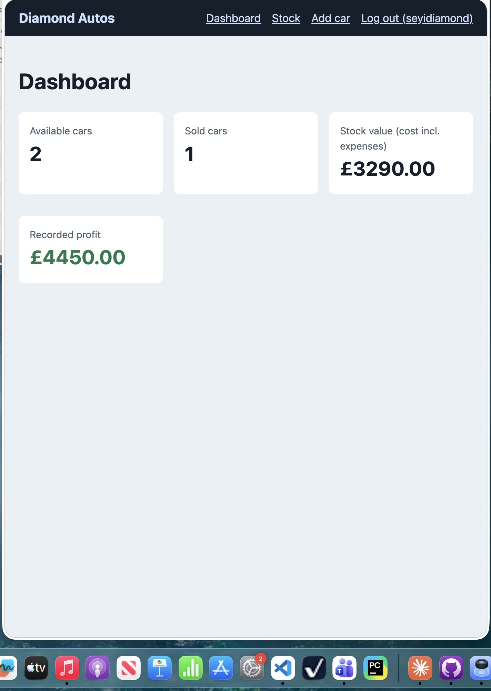
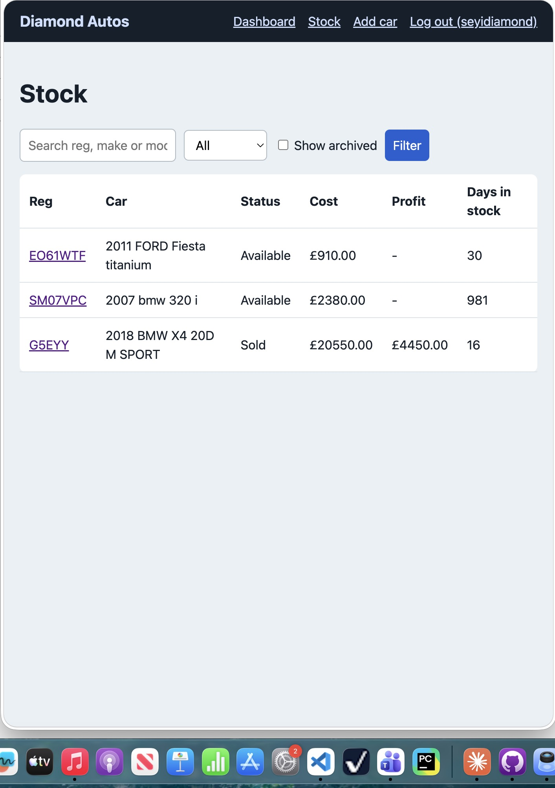
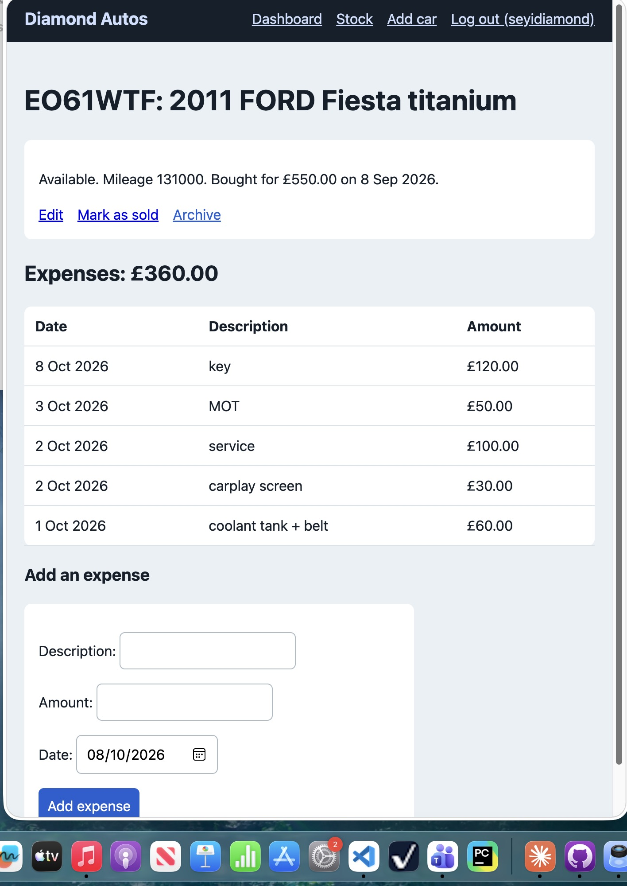
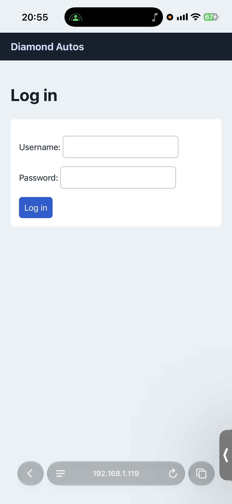

# Diamond Autos — Inventory Manager

A Django web application built for my car-flipping business to track vehicles, purchase costs, expenses and sales profit.

## Why I Built This

I buy cars at auction and resell them. For each vehicle, I need to keep track of what I paid, what I spent preparing it for sale, and how much I eventually sold it for.

I built Diamond Autos to bring those records together in one place. It helps me understand how much money is tied up in available stock, how long vehicles take to sell, and the profit recorded on each sale.

The project combines a practical business need with my development as a Software Engineering student.

## Features

### Vehicle Management
- Add vehicles with registration, make, model and purchase details.
- Edit vehicle records.
- Archive vehicles without deleting their history.
- Search by registration, make or model.
- Filter vehicles by available or sold status.
- View archived records when needed.

### Expense Tracking
- Record multiple expenses against each vehicle.
- Track costs such as tyres, servicing and repairs.
- Include recorded expenses in vehicle cost and profit calculations.
- Prevent new expenses being added after a vehicle is sold.

### Sales and Profit
- Record a vehicle’s sale price and sale date.
- Calculate profit automatically:

**Recorded profit = Sale price − Purchase price − Recorded expenses**

For example:

| Item | Amount |
|---|---:|
| Purchase price | £2,000 |
| Recorded expenses | £500 |
| Total cost | £2,500 |
| Sale price | £3,200 |
| Recorded profit | £700 |

Profit reflects the costs entered into the app. It does not automatically account for unrecorded overheads or tax.

### Dashboard
- Number of available vehicles.
- Number of sold vehicles.
- Money invested in available stock, including recorded expenses.
- Total recorded profit from sales.

### Days in Stock
Shows how long an available vehicle has been held, or how long a sold vehicle took to sell.

### Login and Permissions
Uses Django’s built-in authentication.

| Action | Logged-in user | Staff user |
|---|---|---|
| View dashboard and stock | Yes | Yes |
| Add vehicles and expenses | Yes | Yes |
| Edit vehicles | No | Yes |
| Archive vehicles | No | Yes |
| Mark vehicles as sold | No | Yes |

### Validation
- Rejects negative prices.
- Prevents duplicate vehicle registrations.
- Requires a sale price for sold vehicles.
- Prevents a sale date earlier than the purchase date.

## Screenshots

### Dashboard


### Stock List


### Vehicle Details


### Login


## Technology

- **Python and Django:** backend and application logic.
- **SQLite:** local development database.
- **HTML and CSS:** page structure and styling.
- **JavaScript:** frontend interactions.
- **Django test framework:** automated testing.

## Run Locally

### 1. Download the project

Clone this repository using its GitHub URL, or download and extract the ZIP.

Open a terminal in the project folder containing `manage.py`.

### 2. Create a virtual environment

```bash
python3 -m venv .venv
```

Activate it on macOS or Linux:

```bash
source .venv/bin/activate
```

On Windows PowerShell:

```powershell
.\.venv\Scripts\Activate.ps1
```

### 3. Install dependencies

```bash
python -m pip install -r requirements.txt
```

### 4. Configure local settings

Check `config/settings.py` for any required environment variables and configure them before continuing.

Keep private configuration and secret values out of version control.

### 5. Create the database

```bash
python manage.py migrate
```

### 6. Create an administrator account

```bash
python manage.py createsuperuser
```

This account can sign in and perform staff-only actions.

### 7. Start the development server

```bash
python manage.py runserver
```

Open http://127.0.0.1:8000/ in your browser.

The development server is intended for local use.

## Automated Tests

Run the test suite with:

```bash
python manage.py test
```

The project currently includes 12 automated tests covering profit calculations, validation, permissions and dashboard totals.

## Project Structure

- `config/` — Django project settings and configuration.
- `inventory/` — vehicle models, forms, views, URLs, migrations and tests.
- `templates/` — HTML templates.
- `static/` — styling and frontend assets.
- `screenshots/` — project screenshots.
- `manage.py` — Django management commands.
- `requirements.txt` — Python dependencies.

## Development Focus

This project gave me practical experience with:

- Modelling vehicles and their related expenses.
- Implementing business rules and financial calculations.
- Handling form validation.
- Restricting actions through user permissions.
- Testing application behaviour.
- Turning a personal business problem into a working web application.

## Current Limitations and Future Improvements

- Improve the stock table layout on mobile screens.
- Allow authorised users to correct or undo a sale.
- Support controlled expense adjustments after a sale.
- Expand reporting for selling costs and tax considerations.
- Add login rate limiting.
- Deploy a public demonstration using fictional records.

## Author

Oluwaseyi Adegbite  
Software Engineering student, University of Greenwich.
